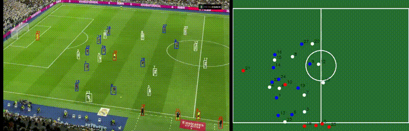
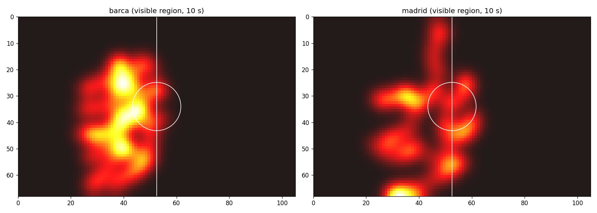
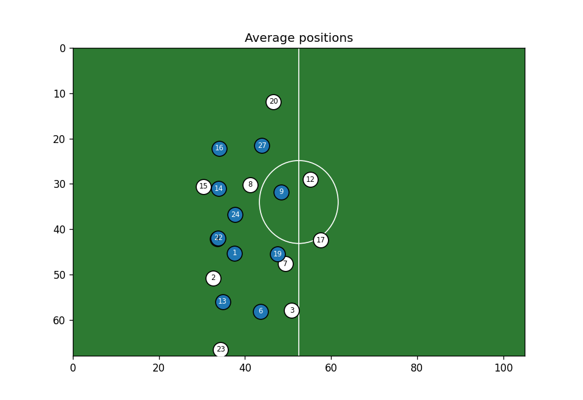

# Football Analytics: Player Tracking and Pitch Mapping

A computer-vision prototype that turns a continuous tactical-camera football clip into tracked,
team-labelled player data, maps every player onto a top-down pitch, and computes simple
analytics (distance, speed, heatmaps and average positions).

**Pipeline:** detection → tracking → team classification → camera-motion compensation →
pitch mapping (homography) → live minimap → analytics



*Left: tracked players with persistent IDs (blue = Barcelona, white = Real Madrid, red = goalkeeper,
referees and staff). Right: the same players mapped onto a top-down pitch.*

## What it does

- **Detects** players with YOLO11
- **Tracks** each player with ByteTrack and gives them a persistent ID
- **Classifies teams** by shirt colour (clustering in LAB colour space, then a majority vote
  over each player's tracked frames). Goalkeepers, referees and staff fall into an "other" group
- **Compensates for camera movement** by tracking grass and line features between frames
- **Maps players to pitch coordinates (metres)** with a homography calibrated on pitch-line landmarks
- **Draws a live top-down minimap** next to the video
- **Merges broken IDs.** When a player leaves the frame and comes back with a new ID, the two are
  joined using team, timing and pitch position
- **Computes** distance covered and top speed per player, plus team heatmaps and average positions
- **Saves** results to CSV (`results/player_stats.csv`)
- **Estimates possession** by crediting the ball to the closest player in each frame

## Tech stack

Python · YOLO11 (Ultralytics) · ByteTrack · OpenCV · NumPy · pandas · scikit-learn · SciPy ·
Matplotlib · Google Colab

## Setup

```bash
git clone https://github.com/<your-username>/football-analytics.git
cd football-analytics
pip install -r requirements.txt
```

A GPU makes a big difference. On Google Colab, choose Runtime → Change runtime type → GPU.

The easiest way to run everything is the notebook:

[](https://colab.research.google.com/github/<your-username>/football-analytics/blob/main/football_analytics.ipynb)

## Usage

Put a short continuous clip (10 to 30 seconds, tactical camera, no cuts or replays) in the folder, then:

```bash
python track.py --video clip.mp4        # writes output.mp4, positions.csv, ball.csv
python analytics.py --video clip.mp4 --team "Real Madrid"   # writes possession.png, heatmap.png
```

The YOLO weights download automatically the first time you run it.

**Using a different clip:** the pitch mapping needs a few pitch-line landmarks (box corners, halfway
line) matched to their real positions in metres. Update the `img_pts` and `pitch_pts` arrays for your
first frame. The notebook includes a cell that draws them on the frame so you can check them.

## Results

Tested on a 10-second clip with 20 outfield players visible (10 per team).

| Metric (visible region, 10 s) | Range across players |
|---|---|
| Distance covered | about 12 to 31 m |
| Top speed (1-second window) | about 6 to 17 km/h |

Full table: [`results/player_stats.csv`](results/player_stats.csv)

| Team heatmap | Average positions |
|---|---|
|  |  |

These are **visible-region stats from a short clip**, a proof that the pipeline works, not match
totals. Ten seconds is too short for meaningful heatmaps, so they show trails, not zones.

## Challenges and fixes

- **Moving camera.** On a panning, zooming camera a standing player looks like they are moving.
  I estimate the camera motion between frames from grass and line features (ignoring players) and
  chain it onto a pitch homography, so every frame gets its own mapping. Staff standing still on the
  touchline stayed within about 2 m across the clip, which showed the tracking held up.
- **Staff counted as players.** Detections whose feet aren't on grass are dropped, but staff standing
  on the grass strip beside the pitch pass that test. They are separated by shirt colour instead,
  where they don't match either team's kit. The per-ID vote then outvotes single-frame mistakes.
  Two staff IDs that still voted as a team were set to "other" by hand.
- **ID switches.** A player who leaves the frame returns with a new ID. IDs are merged when they are
  the same team, start within a few frames of the old one ending, and are within 6 m of where it
  ended. Team counts dropped from 13 and 11 to exactly 10 and 10.
- **Impossible speeds.** The first version reported a 45 km/h top speed. It came from gaps in a
  player's path, where a few missed frames made one step look like a sprint. Gaps are now
  interpolated, paths smoothed, and top speed measured over a one-second window. The same player
  then read 13 km/h.
- **Tiny, noisy ball.** The ball is only a few pixels wide, so it is detected at a lower confidence
  and sudden jumps are rejected.

## Limitations

- **Short clip.** Stats cover about 10 seconds and only the part of the pitch the camera shows.
- **Landmarks placed by hand.** Positions are accurate to roughly 1 to 2 m, so distance and speed
  are estimates.
- **Drift over time.** The camera motion is chained frame to frame, so small errors add up. Fine for
  10 seconds, but a longer clip needs re-anchoring to the pitch lines every few seconds.
- **Colour rules are tuned for one match** (Real Madrid in white, Barcelona in dark red and blue,
  yellow referee). Another match needs re-clustering and re-labelling of the clusters.
- **Camera cuts reset tracking.** Use one continuous shot, ideally the tactical camera.
- **Possession is a simple estimate.** "Closest player to the ball" is not the same as touching it,
  and the ball is missed in many frames.

## Roadmap

- [x] Pitch mapping (homography) for a top-down view
- [x] Speed and distance per player
- [ ] Re-anchor the pitch mapping automatically for longer clips
- [ ] Heatmaps and average positions on 2 to 3 minute clips
- [ ] Pass detection and a pass network
- [ ] Fine-tune YOLO on a football dataset for better ball detection
- [ ] Streamlit dashboard

## Footage

No video is included, since match footage is copyrighted. Use your own clips.
The demo uses a short clip from a publicly available tactical-camera upload
(Real Madrid vs Barcelona), used for personal learning only. Credit to the original uploader.

## Credits

Built with [Ultralytics YOLO11](https://github.com/ultralytics/ultralytics) and ByteTrack.
This is an independent implementation of a common sports-analytics pipeline.
