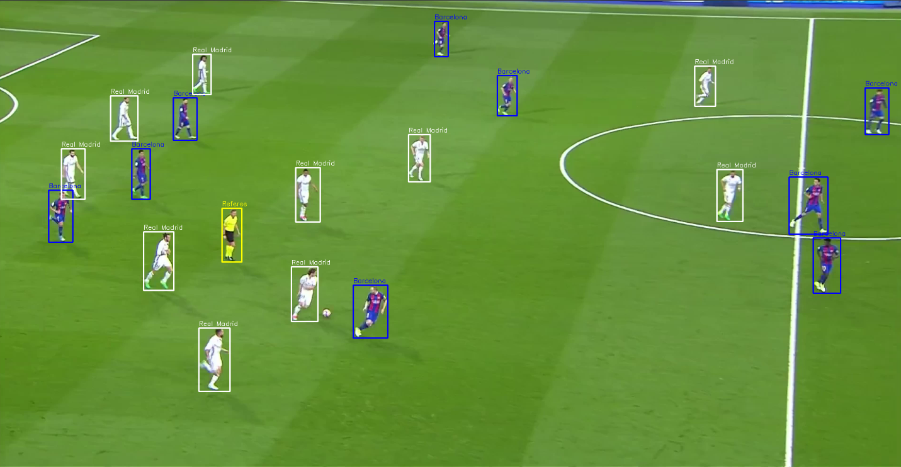
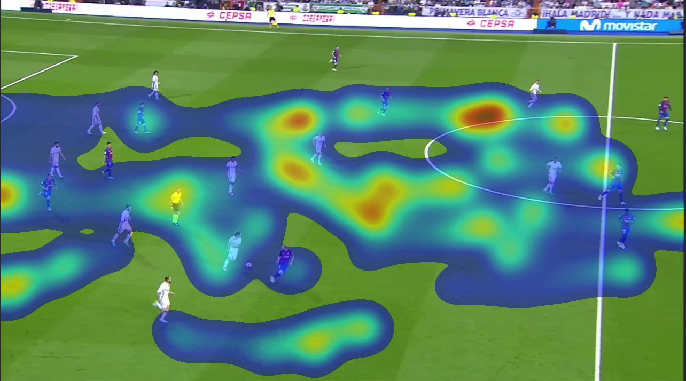

# Football Analytics: Player and Ball Tracking

A computer-vision prototype that turns football match video into tracked, team-labelled
player data, and then into simple analytics (ball possession and a team heatmap).

**Pipeline:** object detection → player tracking → team classification → ball tracking → analytics



## What it does

- **Detects** players and the ball with YOLO11
- **Tracks** each player with ByteTrack and gives them a persistent ID
- **Classifies teams** by shirt colour using HSV colour rules (two teams, referee, goalkeeper)
- **Draws** a ground marker and ID under each player, and a fading trail behind the ball
- **Saves** every player's position (`positions.csv`) and the ball's position (`ball.csv`)
- **Estimates possession** by crediting the ball to the closest player in each frame
- **Draws a team heatmap** from the saved positions

## Tech stack

Python · YOLO11 (Ultralytics) · ByteTrack · OpenCV · NumPy · pandas · Matplotlib · Google Colab

## Setup

```bash
git clone https://github.com/<your-username>/football-analytics.git
cd football-analytics
pip install -r requirements.txt
```

A GPU makes a big difference. On Google Colab, choose Runtime → Change runtime type → GPU.

## Usage

Put a short match clip (10 to 30 seconds, one continuous shot) in the folder, then:

```bash
python track.py --video clip.mp4        # writes output.mp4, positions.csv, ball.csv
python analytics.py --video clip.mp4 --team "Real Madrid"   # writes possession.png, heatmap.png
```

The YOLO weights download automatically the first time you run it.

## Results

| Possession estimate | Team heatmap |
|---|---|
|  |  |

## Design notes

- **Tracker tuning.** The default ByteTrack settings lost players too often on a panning camera,
  so IDs kept resetting. `bytetrack_football.yaml` keeps lost tracks for about 3 seconds and
  made IDs much more stable.
- **Team colour smoothing.** Each player's team is the most common guess over their last 30 frames,
  so shade and motion blur don't make the colour flicker.
- **Staff filtering.** Detections whose feet aren't on grass are ignored, and a solid navy torso
  is treated as staff, not as a striped shirt.
- **Goalkeeper rule.** Grass is also green, so the goalkeeper rule only matches the brighter
  neon-green hue range. I measured grass and kit pixels to set it.
- **Ball.** The ball is only a few pixels wide, so it is detected at a lower confidence and
  sudden jumps are rejected.

## Limitations

- **Colour rules are tuned for one match** (Real Madrid in white, Barcelona in blue and dark red,
  yellow referee). Other kits need new HSV ranges in `get_team()` in `track.py`.
- **Positions are in screen pixels.** When the camera pans or zooms, positions drift, so the heatmap
  and possession numbers are rough. Real distance and speed need a pitch mapping (homography).
- **Camera cuts reset tracking.** Use one continuous shot, ideally a fixed tactical camera.
- **Possession is a simple estimate.** "Closest player to the ball" is not the same as touching it,
  and the ball is missed in many frames.
- Tested on a short clip, not on full matches.

## Roadmap

- [ ] Pitch mapping (homography) for a top-down view
- [ ] Speed and distance per player
- [ ] Pass and shot detection
- [ ] Accurate heatmaps in pitch coordinates
- [ ] Fine-tune YOLO on a football dataset for better ball detection

## Footage

No video is included, since match footage is copyrighted. Use your own clips.
Footage in the original development was a short broadcast highlight, used for personal learning only.

## Credits

Built with [Ultralytics YOLO11](https://github.com/ultralytics/ultralytics) and ByteTrack.
This is an independent implementation of a common sports-analytics pipeline.
